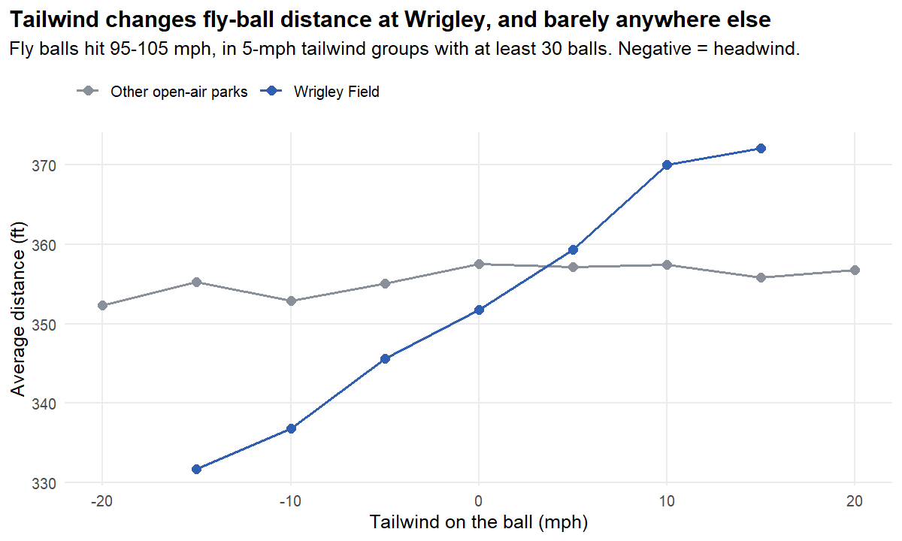

# Wrigley Field Wind Model

How much does the wind at Wrigley Field change batted-ball distance and home runs, and how many home
runs should we expect given a weather forecast?

**[Read the full report](report/wrigley_wind.md)** for the reasoning, charts and validation.



## Findings

- **Wind matters far more at Wrigley.** Each mph of tailwind adds about 1 foot to a fly ball at Wrigley,
  compared with about 0.2 feet at other open-air parks.
- **A 15 mph tailwind multiplies a ball's home-run odds by about 5.** The effect is largest on borderline
  balls: a 101 mph ball at 28° to center goes from about 6% in a headwind to about 59% in a tailwind.
- **It matters by game more than by season.** The middle half of games fall between about -0.34 and +0.21
  home runs from wind, with 2 or more on the biggest days. Over a season it mostly cancels, at about 1-6%.

## How it holds up

- **The wind effect held up on unseen seasons.** Weather improved the Brier score in all four test seasons
  (2022-2025), and the effect stayed stable at about 10-12% higher odds per mph.
- **Home-run totals ran high.** Given each ball's actual contact, the model predicted 4-20% too many home
  runs (238 vs. 201 in 2025), because the same contact has been carrying less since 2021. The final model
  trains on 2022-2025 to reduce this.
- **The pre-game forecast is better at ranking days than exact totals.** Its average miss on 2025 was 1.46
  home runs per game, vs. 1.67 for always guessing the past average.

## Reproducing the analysis

Run from the project root with R 4.6. Packages: DBI, duckdb, dplyr, jsonlite, ggplot2, mgcv.
The data isn't in this repository, so the first two steps download it.

```
Rscript R/01_pull_games.R 2019 2021 2022 2023 2024 2025
Rscript R/02_pull_statcast.R 2019 2021 2022 2023 2024 2025
Rscript R/03_build_batted_balls.R
Rscript R/04_explore.R
Rscript R/05_models.R
Rscript R/06_validate.R
Rscript R/07_results.R
```

The download takes a couple of hours and can be stopped and rerun safely. The other steps take under a
minute each. Results are written to `output/`.

## Files

| File | Purpose |
|---|---|
| `R/config.R` | Packages, database connection, wind-direction mapping |
| `R/analysis_helpers.R` | Shared data loading, model, scoring and chart functions |
| `R/01_pull_games.R` | Games, venues and weather from the MLB Stats API |
| `R/02_pull_statcast.R` | Pitch-level Statcast data from Baseball Savant |
| `R/03_build_batted_balls.R` | Batted-ball table with spray angle and tailwind |
| `R/04_explore.R` | Wind conditions, raw comparisons, Wrigley vs. other parks |
| `R/05_models.R` | Distance and home-run models, built up step by step |
| `R/06_validate.R` | Testing on seasons the model never saw |
| `R/07_results.R` | Final model, home runs from wind, forecast test |
| `output/` | Result tables and charts |
| `report/` | The full write-up |

## How this was built

I built this project with help from an AI assistant, Claude, and used it to learn the methods as I went.

- **My work:** I chose the question from ideas we brainstormed, worked through the analysis step by step
  in R and SQL, ran the models, and interpreted the results. Claude reviewed my interpretations and
  corrected them where they were wrong.
- **Claude's work:** Claude wrote the data download scripts and the starter code for each analysis step,
  combined the work into the scripts in this repository, and drafted the report, which I then reviewed.

## Limitations

- Wind is one reading per game in eight coarse directions, so gusts and changes are missed.
- The what-if estimates assume players don't adjust to the wind.
- The forecast describes a typical Wrigley game and knows nothing about lineups or starting pitchers.
- The cause of the drop in carry since 2021 isn't identified.
- "Varies" wind readings are excluded, and "Calm" is treated as zero wind.
- `hit_distance_sc` for caught balls is where the ball was caught, not where it would have landed.
