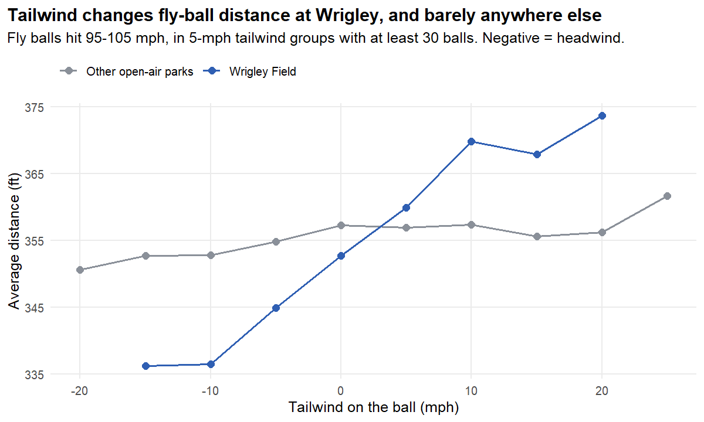
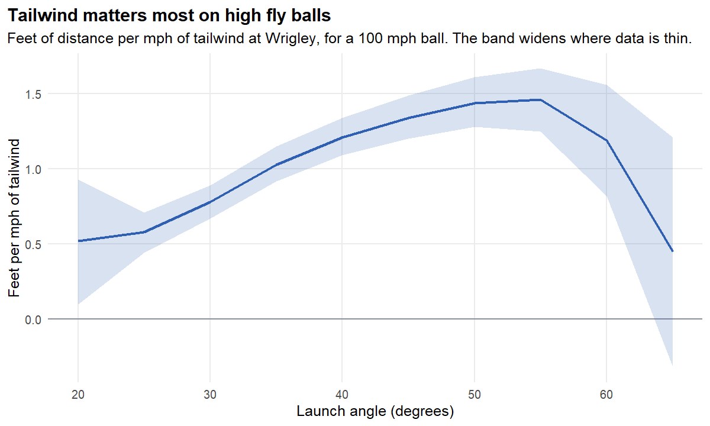
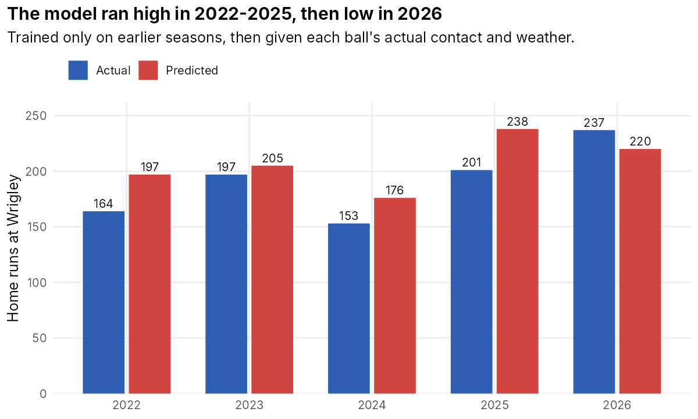
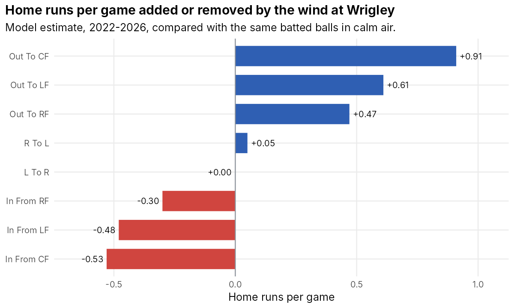

Wrigley Field has a reputation for playing very differently depending on the wind. I wanted to
measure that: how much distance and how many home runs the wind adds or removes, and how many home
runs to expect given a weather forecast.

**The short answer:** each mph of tailwind adds about 1 foot to a fly ball at Wrigley, compared with
about 0.2 feet at other open-air parks. A 15 mph tailwind multiplies a ball's odds of being a home
run by about 5, and the effect is largest on balls that land near the wall. When tested on seasons
it hadn't seen, the wind effect held up, but home-run totals drifted: the model predicted too many
home runs in 2022-2025 and too few in 2026. That problem is covered in
[Testing on new seasons](#testing-on-new-seasons).

## Data

- **Batted balls:** about 5.0 million regular-season pitches from Baseball Savant (Statcast) for 2019
  and 2021-2026. I left out the shortened 2020 season. The 2026 season was added in November 2026,
  after the first version of this analysis, and every result below was rerun with it.
- **Weather:** game-time temperature and wind from the MLB Stats API, joined on MLB's game ID.
- **Storage:** a local DuckDB database, with a resumable download so an interruption can't leave
  duplicate or partial data.

The models use fly balls and line drives. No ground ball or popup left the park in this data, so wind
can't change that outcome for them. Home runs here are balls that left the park: Statcast also records
inside-the-park home runs as home runs, but those stay in the field, so I left out all 77 of them (1 at
Wrigley).

## Measuring the wind on each ball

MLB reports one wind reading per game, relative to the field, like "12 mph, Out To CF." But each
ball goes in its own direction. So I converted each ball's landing spot into a spray angle and
calculated its tailwind:

> tailwind = wind speed × cos(angle between the ball's path and the wind)

A ball hit straight with a 10 mph wind gets +10, a ball at a right angle to it gets 0, and a ball hit
straight into it gets -10. This also shows why crosswinds aren't simply neutral: they help balls hit
to one side and hurt balls hit to the other.

## What the raw data shows

Wrigley games with the wind blowing out average 3.64 home runs, compared with 1.82 when it's blowing
in. But that comparison can't be taken at face value, because wind-out days are also about 10 degrees
warmer (76.0° vs. 65.8°), and warm air helps the ball carry too.

The bigger surprise came from comparing Wrigley with other parks, using fly balls hit equally hard:

Distance rises steadily with tailwind at Wrigley, and it's nearly flat elsewhere. My hypothesis is
ballpark design: Wrigley is low and open to the wind off Lake Michigan, while many parks have tall
grandstands that block or redirect it, so one wind reading says less about what the ball experiences.
I haven't tested this. Estimating the effect separately for each park would be a good way to do it.

## Models

I built up the distance model in steps, tracking the tailwind estimate at each one.

| Model | R² | AIC | Feet per mph of tailwind |
|---|---:|---:|---:|
| Tailwind only | 0.009 | 80,133 | 0.80 |
| Add exit velocity, launch angle, temperature | 0.874 | 65,288 | 1.04 |
| Launch angle as a quadratic | 0.901 | 63,549 | 1.12 |
| Smooth launch angle (GAM) | 0.905 | 63,296 | 1.10 |
| Smooth exit velocity too | 0.908 | 63,077 | 1.09 |
| Exit velocity and launch angle interact | 0.919 | 62,093 | 1.07 |
| Add hit direction | 0.925 | 61,591 | 1.05 |

Three things stand out:

- **A low R² didn't mean wind was unimportant.** Wind alone explains about 1% of the variation in
  distance, because contact dominates. But about 1 foot per mph means a 15 mph tailwind adds about 15
  feet, which can turn a warning-track out into a home run.
- **Controls pushed the estimate in both directions.** Temperature was inflating it, since warm days and
  tailwinds go together (a correlation of 0.35). Slightly softer and higher contact on tailwind balls
  was hiding part of it (correlations of -0.03 with exit velocity and 0.07 with launch angle).
- **The estimate is stable.** It stayed close to 1 foot per mph through major changes to the model, so
  the result doesn't depend on one modeling choice.

Fitting Wrigley and other open-air parks in one model with an interaction gives **1.13 feet per mph at
Wrigley and 0.19 elsewhere**. Every ball in a game shares one wind reading, so the balls aren't
independent. Resampling whole games gives 95% intervals of 1.04-1.23 at Wrigley and 0.17-0.21
elsewhere, so the gap is clear.

The effect also isn't the same on every fly ball:

It rises from about 0.6 feet per mph at 20° to about 1.5 at 45-55°. It appears to fall at higher
angles, but only 66 of 7,197 fly balls were hit above 60°, so that part is uncertain. The band is a 95%
interval from resampling whole games.

## From distance to home runs

Home runs are a yes-or-no outcome, so I used a logistic GAM with the same terms. In this model, each
mph of tailwind raises the odds of a home run by about 12%, or about 5.4 times the odds for a 15 mph
tailwind. This model and the distance models above use every Wrigley season (2019 and 2021-2026). The
final model, trained on 2022-2026, gives nearly the same multiplier (5.38). Odds aren't probability,
though, and the same multiplier matters very differently depending
on the ball:

| Ball, hit to center | 15 mph headwind | Calm | 15 mph tailwind |
|---|---:|---:|---:|
| Weak: 90 mph, 30° | under 0.1% | under 0.1% | 0.1% |
| **Borderline: 101 mph, 28°** | **5.0%** | **22.3%** | **60.7%** |
| Crushed: 110 mph, 28° | 58.8% | 88.5% | 97.6% |

Weak contact stays in the park, and crushed balls mostly go out anyway. **The wind matters most on
balls that land near the wall**, because that's where 30 feet can decide the outcome.

## Testing on new seasons

To test the model, I trained it only on earlier seasons and scored it on each later one. I split by
season rather than at random, because balls from one game share conditions, and a random split would
also let the model train on the future.

**What held up.** Adding weather improved the Brier score in all five test seasons. To separate the
wind from temperature, I also scored a model with temperature but no wind. Adding the wind to it
improved the Brier score in every season too, and the wind effect stayed stable, at about 10-12% higher
odds per mph.

| Test season | Brier, no weather | Brier, temperature only | Brier, with weather | Odds ratio per mph |
|---|---:|---:|---:|---:|
| 2022 | 0.0317 | 0.0299 | 0.0275 | 1.118 |
| 2023 | 0.0306 | 0.0295 | 0.0272 | 1.107 |
| 2024 | 0.0325 | 0.0311 | 0.0302 | 1.111 |
| 2025 | 0.0350 | 0.0309 | 0.0267 | 1.103 |
| 2026 | 0.0353 | 0.0318 | 0.0281 | 1.113 |

**What didn't.** Calibration had looked excellent on the training data, within about 1.5 percentage
points in every probability range, but the home-run totals missed
in every test season, even when the model was given each ball's actual contact. It predicted too many
in 2022-2025 and too few in 2026:

The miss was 18% too high for 2025 (238 predicted, 201 actual) and 7% too low for 2026 (220 predicted,
237 actual). In both seasons it's largest for balls predicted at 25-50%: in 2025 the model said 36.9%
and 22.8% left the park, and in 2026 it said 36.4% and 45.7% did. That's the part of the S-curve where a
small change in carry matters most. The model still ranked balls well, so this mainly matters for
forecasting totals.

**Why it happens.** This is drift rather than overfitting: the relationship itself changed. Among
hard-hit balls at good launch angles, exit velocity barely moved, but distance and home-run rate fell
through 2025 and then partly came back in 2026:

| Season | Avg. exit velocity | Avg. distance | HR rate | Avg. tailwind |
|---|---:|---:|---:|---:|
| 2019 | 104.5 | 402 ft | 73.2% | +0.7 |
| 2021 | 104.9 | 399 ft | 76.4% | +1.3 |
| 2022 | 104.5 | 392 ft | 62.5% | +0.9 |
| 2023 | 104.4 | 395 ft | 66.8% | +0.3 |
| 2024 | 104.6 | 390 ft | 58.3% | -2.0 |
| 2025 | 104.0 | 386 ft | 58.8% | -0.9 |
| 2026 | 104.4 | 393 ft | 69.1% | -0.5 |

Less tailwind explains only about 2 of the 13 feet lost from 2021 to 2025, and it's already in the model.
Then 2026 got back about 7 of those feet with almost the same tailwind. Something other than the wind
changes how far the same contact carries from season to season. It could be the ball, how balls are
stored, or air conditions I don't measure, and this data can't separate those. 2026 also shows the drift
isn't a steady decline that a model can simply follow.

**A fix that didn't hold up.** In the first version of this analysis, training only on recent seasons
(2022-2024) improved the 2025 test, from 238 predicted home runs to 224 (201 actual), and the Brier score
from 0.0267 to 0.0252. With 2026 as a second test season, the same idea made things worse. Training on
2022-2025 predicted 207 home runs for 2026 against 220 from all seasons (237 actual), with a Brier score
of 0.0285 vs. 0.0281. Recent seasons had learned the low-carry years, and 2026 carried more like the
older ones.

Comparing the two choices in every season where both are possible gives a mixed picture:

| Test season | Brier, all earlier seasons | Brier, 2022 onward only | Predicted HR, all earlier | Predicted HR, 2022 onward | Actual HR |
|---|---:|---:|---:|---:|---:|
| 2023 | 0.0272 | 0.0281 | 205 | 180 | 197 |
| 2024 | 0.0302 | 0.0292 | 176 | 163 | 153 |
| 2025 | 0.0267 | 0.0252 | 238 | 224 | 201 |
| 2026 | 0.0281 | 0.0285 | 220 | 207 | 237 |

Recent-only training won two seasons and lost two, and it was slightly better on average. The final
model still uses 2022 onward (now 2022-2026), so its estimates sit inside the current era. But a
recent-only window isn't a reliable fix, and the drift is still open.

## Results

The what-if question: for each ball, what's its home-run chance with the actual wind, compared with no
wind?

- **By game:** the middle half of games fall between about -0.38 and +0.27 home runs from wind. On the
  biggest days it's much larger: the top estimate is +4.9, on May 20, 2022, with 25 mph out to center
  and 85°. That game had 11 home runs, and it's an extreme case.
- **By season:** it mostly cancels, adding or removing about 1-7% of a season's home runs. The largest is
  2024, at about 10 fewer out of 153. In 2026 the wind added about 6 of Wrigley's 237 home runs.
- **Skew:** the wind can add more than it can remove, since a game can only lose the home runs it would
  otherwise have had.

## The forecast

Before a game, nobody knows what contact there will be. So the forecast replays Wrigley's 2022-2026
batted balls under the forecast weather and adds up their home-run chances per game. It assumes the
average carry of those seasons. Even the final model, which was trained on them, expects 224 home runs
for 2025 (201 actual) and 215 for 2026 (237 actual), so a season can run about 10% above or below these
numbers.

| Weather | Expected home runs |
|---|---:|
| Calm, 70° | 2.35 |
| 10 mph out to center, 75° | 3.23 |
| 20 mph out to center, 85° | 4.33 |
| 10 mph in from center, 60° | 1.50 |
| 20 mph in from center, 50° | 0.85 |
| 15 mph left to right, 70° | 2.33 |

**Does it work?** I tested it on 2026 using a model trained on 2022-2025, the same training rule as the
final model. Its average miss was 1.56 home
runs per game, about 9% better than always guessing the past average (1.71). That's still a large miss
for one game, because a lot of a game's home runs can't be known in advance. The first version, tested
on 2025 with a model trained on 2022-2024, missed by 1.46 vs. 1.67, about 13% better.

| Forecast group | Games | Forecast | Actual |
|---|---:|---:|---:|
| Low | 27 | 1.50 | 1.48 |
| Middle | 27 | 2.16 | 3.22 |
| High | 27 | 3.08 | 4.07 |

It ranks days in the right order, but it underestimates the middle and high groups by about one home
run per game.

It also ran low overall in 2026, at 2.25 forecast vs. 2.93 actual. Wrigley's 237 home runs in 2026 were
the most since 2021 (241). This time the two errors push the same way. 2026 had more balls in
the air than the seasons being replayed (27.2 per game vs. 25.0), though the same number of hard-hit
balls at good angles (2.5 per game), so replaying old contact made the forecast too low. And contact
carried more than the model expected, which also pushed it too low. In 2025 the errors had pushed in
opposite directions: more hard contact (3.2 per game vs. 2.3) made the forecast too low, while the
model's overestimate of carry pushed it up.

## Limitations

- **One wind reading per game.** Gusts and changes during a game are missed. This kind of measurement
  error tends to understate the true wind effect.
- **The what-if assumes players don't adjust.** Pitchers may pitch differently, and outfielders may play
  deeper, on windy days.
- **The forecast describes a typical game.** It knows nothing about the lineups or starting pitchers,
  and it assumes the average carry of 2022-2026.
- **Drift isn't explained.** I can show that carry changes from season to season, down through 2025 and
  back up in 2026, but not why.

## What I'd do next

- Add lineups and starting pitchers to the pre-game forecast.
- Handle drift directly with a rolling training window or a season effect, tested across several seasons.
- Estimate the wind effect separately for each park to test the ballpark-design hypothesis.
